<div align="center">

# Cloud-Native DevSecOps Platform with AI-Assisted Remediation

**Final-year engineering project (PFE) · ESPRIT × SFM Technologies · 2025–2026**

End-to-end DevSecOps platform for a Spring Boot / Angular microservices application on **DigitalOcean Kubernetes (DOKS)**:
security checks at every stage of a **GitLab CI/CD** pipeline, **GitOps** delivery with **Argo CD**, **Policy-as-Code** with OPA,
runtime threat detection with **Falco**, and an **AI agent (Llama 3.3 70B via Groq, RAG on internal security standards)**
that explains alerts and proposes fixes in **Slack**, with a human approving each fix before it is applied.


</div>

---

## Table of contents

- [Project overview](#project-overview)
- [Architecture](#architecture)
- [Technologies used](#technologies-used)
- [DevSecOps workflow](#devsecops-workflow)
- [CI/CD pipeline](#cicd-pipeline)
- [Kubernetes deployment](#kubernetes-deployment)
- [Security controls](#security-controls)
- [AI-powered remediation](#ai-powered-remediation)
- [Installation guide](#installation-guide)
- [Screenshots](#screenshots)
- [Demo video](#demo-video)
- [Project results](#project-results)
- [Repository structure](#repository-structure)
- [Known limitations](#known-limitations)
- [Author and contact](#author-and-contact)

---

## Project overview

At SFM Technologies, security checks on the delivery chain were mostly manual and late. They happened after deployment, results were spread across several tools, and fixing a runtime alert meant reading logs and writing the patch by hand.

This project builds a platform that moves security **left** (into the pipeline) and **right** (into the running cluster), and closes the loop with an AI agent:

1. **Shift-left.** Every commit runs build, unit tests, SAST, SCA, secret detection, Policy-as-Code, image scanning, SBOM generation, image signing and DAST.
2. **GitOps delivery.** Argo CD keeps the cluster in sync with the Kubernetes manifests stored in Git, with automatic sync, prune and self-heal.
3. **Runtime protection.** Falco (eBPF) watches syscalls inside the cluster, and Falcosidekick routes its alerts.
4. **AI-assisted remediation.** A Python agent receives findings and Falco alerts, retrieves the matching internal security rules (RAG), asks **Llama 3.3 70B** (Groq API) for an analysis and a fix, and posts them to Slack. A human approves or rejects each fix.
5. **Single source of truth.** Every finding is imported into **DefectDojo**.

The workload is **EduBoard**, an education-management application built from Spring Boot microservices and an Angular frontend. My contribution is the DevSecOps platform around it: pipeline, policies, cluster, GitOps, runtime security, monitoring and the AI agent.

---

## Architecture

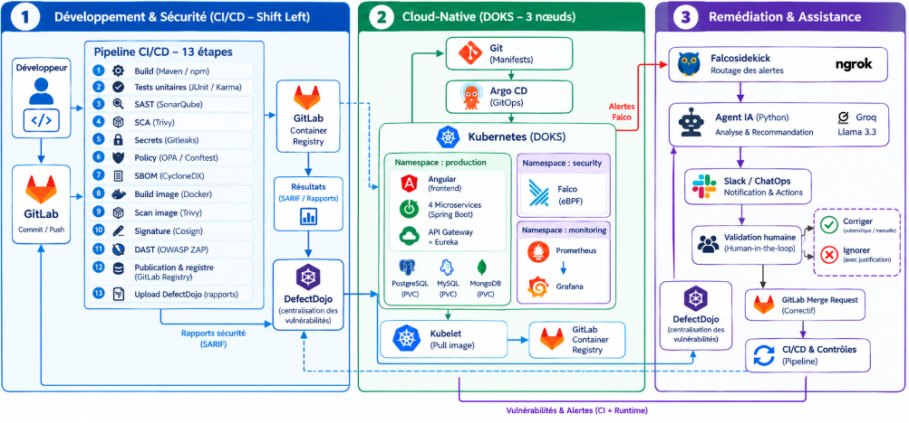

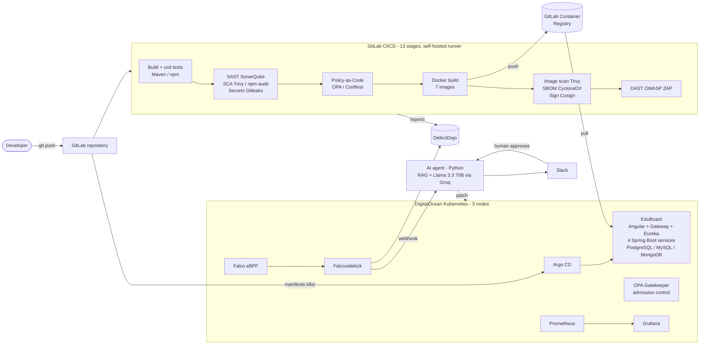

<details>
<summary>Physical architecture (DOKS cluster, CI VM, external services)</summary>

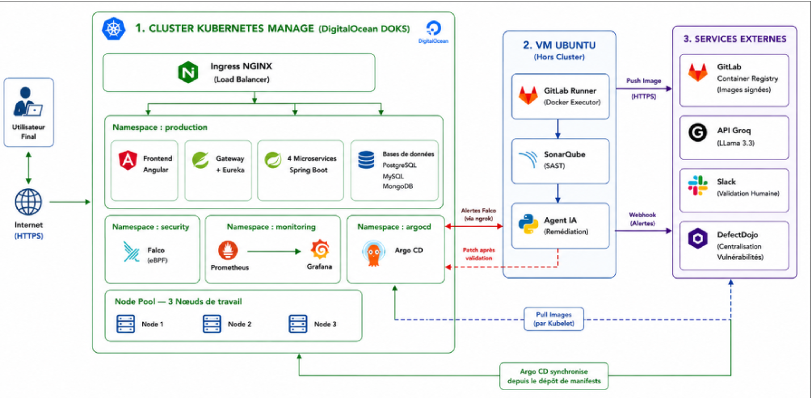

</details>

---

## Technologies used

| Area | Tools |
|---|---|
| Cloud & orchestration | DigitalOcean Kubernetes (DOKS, 3 worker nodes), Kubernetes, Helm, `doctl` |
| CI/CD & GitOps | GitLab CI/CD (self-hosted runner, Docker executor), Argo CD, GitLab Container Registry |
| Containers | Docker (7 images), a hardened `Dockerfile.secure` per service (non-root UID 1001) |
| SAST / SCA / secrets | SonarQube, Trivy (filesystem + image), npm audit, Gitleaks, Qwiet AI preZero |
| Policy-as-Code | OPA / Conftest (Rego in CI), OPA Gatekeeper (admission control) |
| Supply chain | CycloneDX SBOM (generated by Trivy), Cosign image signing |
| DAST | OWASP ZAP baseline scan |
| Pipeline audit | Plumber (GitLab CI component) |
| Runtime security | Falco (eBPF), Falcosidekick |
| Vulnerability management | DefectDojo (API v2 imports) |
| Observability | Prometheus, Grafana (kube-prometheus-stack), ServiceMonitors |
| AI remediation | Python, Groq API, Llama 3.3 70B, RAG over internal standards, Slack |
| Application | Java 17, Spring Boot 2.6, Spring Cloud (Gateway, Eureka), Angular 14, PostgreSQL, MySQL, MongoDB |

---

## DevSecOps workflow

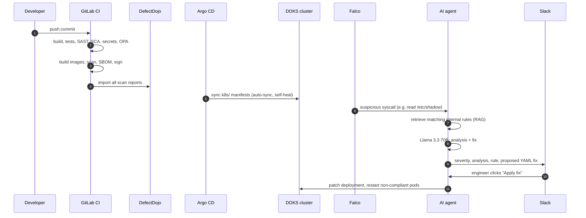

---

## CI/CD pipeline

The pipeline is defined in [`.gitlab-ci.yml`](.gitlab-ci.yml). It has **13 stages and 32 jobs** in the observed run, and parallel matrix jobs scan each microservice separately.

| # | Stage | Jobs | What it does |
|---|---|---|---|
| 1 | `build-shared` | `install-common-*` | Builds the shared Maven modules |
| 2 | `build-all` | `build-all-backend`, `build-frontend-app` | Compiles every service and the Angular app |
| 3 | `test-unitaires` | `backend-tests`, `frontend-tests` | JUnit / Jest with coverage (JaCoCo, lcov) |
| 4 | `security-scan` | `sonarqube-backend` (matrix), `sonar-frontend`, `sca-scan-backend` (matrix), `sca-scan-frontend`, `secret-detection` | SAST, dependency scanning, Gitleaks on the full history |
| 5 | `policy-check` | `opa-gatekeeper-check` | Conftest checks every manifest against `k8s/kubernetes.rego` |
| 6 | `docker-build` | `docker-build-backend`, `docker-build-frontend` | Builds the 7 images and pushes them to the GitLab registry |
| 7 | `docker-scan` | `container_scan`, `generate-sbom`, `sign-images` | Trivy image scan, CycloneDX SBOM, Cosign signature |
| 8 | `security-audit` | `plumber` | Audits the pipeline configuration itself |
| 9 | `test-security` | `qwiet-prezero-scan` | Additional code analysis with Qwiet AI |
| 10 | `deploy-cloud` | `deploy-to-digitalocean` | Applies the manifests and installs or updates Falco and kube-prometheus-stack with Helm |
| 11 | `dast-scan` | `owasp-zap-dast` | ZAP baseline scan of the API Gateway and the frontend |
| 12 | `upload-defectdojo` | `upload-*` | Imports Gitleaks, Trivy, ZAP, SonarQube and OPA results into DefectDojo |
| 13 | `ai-remediation` | `ai-remediation-agent`, `test-falco-ai-alert` (manual) | Sends policy violations to the AI agent and simulates an attack to test the runtime loop |

All credentials (`SONAR_TOKEN`, `KUBECONFIG_CONTENT`, `COSIGN_PRIVATE_KEY`, `DEFECTDOJO_TOKEN`, `GROQ_API_KEY`, `SLACK_WEBHOOK_URL`, …) are **masked GitLab CI/CD variables**. None is stored in this repository.

---

## Kubernetes deployment

- **Cluster:** DigitalOcean Kubernetes with 3 worker nodes, created with `doctl`. The frontend and the API Gateway are exposed through DigitalOcean LoadBalancer services.
- **Manifests:** [`k8s/`](k8s) contains Deployments and Services for the 7 application components, the 3 databases with persistent volumes, and ServiceMonitors for Prometheus.
- **GitOps:** [`gitops/argocd-application.yaml`](gitops/argocd-application.yaml). Argo CD watches `k8s/` with `automated: { prune: true, selfHeal: true }`, so a manual change in the cluster is reverted to the state stored in Git.
- **Security add-ons (Helm):** Falco + Falcosidekick and kube-prometheus-stack, installed by the `deploy-to-digitalocean` job.
- **Admission control:** the OPA Gatekeeper [`ConstraintTemplate`](k8s/opa-template.yaml) and [`Constraint`](k8s/opa-constraint.yaml) reject Deployments without resource limits or with privileged containers.

---

## Security controls

| Layer | Control | Implementation |
|---|---|---|
| Code | SAST, quality gate | SonarQube, one project per microservice |
| Dependencies | SCA | Trivy `fs` (Maven), `npm audit` (Angular) |
| Secrets | Secret detection on the full Git history | Gitleaks (`GIT_DEPTH: 0`, redacted SARIF) |
| IaC / manifests | Policy-as-Code in CI | [`k8s/kubernetes.rego`](k8s/kubernetes.rego): resource limits required, `runAsNonRoot: true` required, privileged containers forbidden |
| Admission | Policy enforcement in the cluster | OPA Gatekeeper |
| Images | Vulnerability scan, hardened builds | Trivy image scan (HIGH/CRITICAL), `Dockerfile.secure` (non-root user) |
| Supply chain | SBOM + signature | CycloneDX, Cosign (private key stored in a masked variable) |
| Running app | DAST | OWASP ZAP baseline scan |
| Runtime | Threat detection | Falco (eBPF) → Falcosidekick → AI agent + DefectDojo |
| Governance | Centralised findings | DefectDojo (product `DevsecopsApp`, engagement `Pipeline-Full-Scan`) |

---

## AI-powered remediation

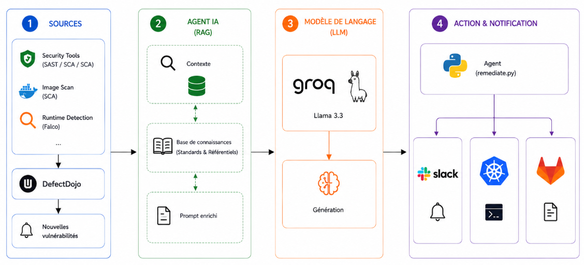

The agent works in two modes.

**1. Pipeline mode: Policy-as-Code violations.** When `opa-gatekeeper-check` reports violations, the `ai-remediation-agent` job loads the internal standards in [`knowledge_base/sfm_security_standards.md`](ai-remediator/knowledge_base/sfm_security_standards.md) together with the Conftest report. It asks the LLM for a corrected YAML snippet that cites the exact internal rule, then posts the answer to Slack.

- [`ai-remediator/remediate_groq.py`](ai-remediator/remediate_groq.py) is the **Groq / Llama 3.3 70B** version documented in the PFE report.
- [`ai-remediator/remediate.py`](ai-remediator/remediate.py) is the variant currently called by the CI job. It uses the same prompt and RAG design, but calls Google Gemini.

**2. Runtime mode: Falco alerts.** Falcosidekick forwards Falco events by webhook to the agent, which ran as a Flask + Slack Bolt service during the project. The agent:

1. classifies the alert (severity, process, container, image);
2. retrieves the matching internal rules (RAG);
3. asks Llama 3.3 70B for an analysis and a fix;
4. posts both to Slack with **"Apply fix"** and **"View in DefectDojo"** buttons;
5. once a human approves, patches the deployment and restarts the non-compliant pods.

> The runtime version of the agent (Flask / Slack Bolt) ran on the project VM during the PFE. Its source is not in this repository yet. The screenshots below show how it behaved. You can replay the attack scenario with the manual `test-falco-ai-alert` job.

---

## Installation guide

> The DOKS cluster, the SonarQube and DefectDojo instances and the Groq/Slack integrations used during the PFE have been shut down. These steps describe how to rebuild the platform in your own accounts.

**Prerequisites:** a GitLab project with a runner (Docker executor), a Kubernetes cluster (DOKS or any CNCF-conformant cluster), `kubectl`, `helm`, a SonarQube and a DefectDojo instance, a Groq API key and a Slack incoming webhook.

```bash
# 1. Clone
git clone https://github.com/iyedboubakri12/devsecops-ai-remediation-platform.git
cd devsecops-ai-remediation-platform

# 2. Configure masked CI/CD variables in GitLab (Settings > CI/CD > Variables)
#    SONAR_TOKEN, KUBECONFIG_CONTENT, COSIGN_PRIVATE_KEY, DEFECTDOJO_URL,
#    DEFECTDOJO_TOKEN, GROQ_API_KEY, SLACK_WEBHOOK_URL, FALCO_WEBHOOK_URL,
#    STAGING_API_URL, STAGING_FRONTEND_URL

# 3. Cluster add-ons
kubectl create namespace argocd
kubectl apply -n argocd -f https://raw.githubusercontent.com/argoproj/argo-cd/stable/manifests/install.yaml
kubectl apply -f https://raw.githubusercontent.com/open-policy-agent/gatekeeper/master/deploy/gatekeeper.yaml
kubectl apply -f k8s/opa-template.yaml && kubectl apply -f k8s/opa-constraint.yaml

# 4. GitOps: set repoURL in gitops/argocd-application.yaml to your repository, then
kubectl apply -f gitops/argocd-application.yaml

# 5. Push to main: the pipeline builds, scans, signs, deploys Falco + monitoring and runs DAST
git push origin main
```

**Run the policy check locally**

```bash
conftest test k8s/*.yaml -p k8s/kubernetes.rego
```

**Run the AI agent locally** (with an `opa-report.json` in the working directory)

```bash
pip install requests
export GROQ_API_KEY=...        # never commit it
export SLACK_WEBHOOK_URL=...   # optional
python ai-remediator/remediate_groq.py
```

---

## Screenshots

All screenshots come from the real project environment (2026).

### CI/CD pipeline (GitLab, 32 jobs, passed)
| | |
|---|---|
| 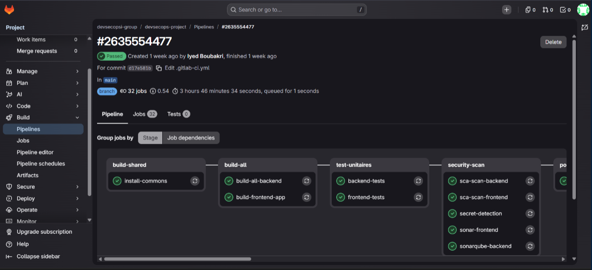 | 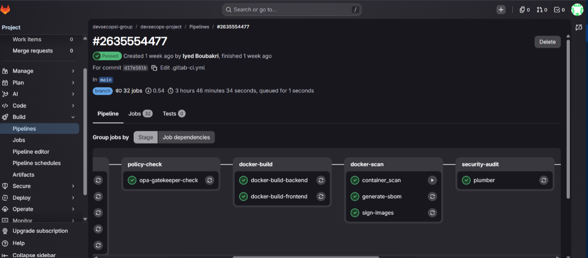 |
| 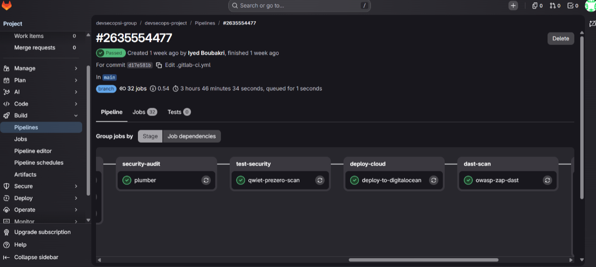 | 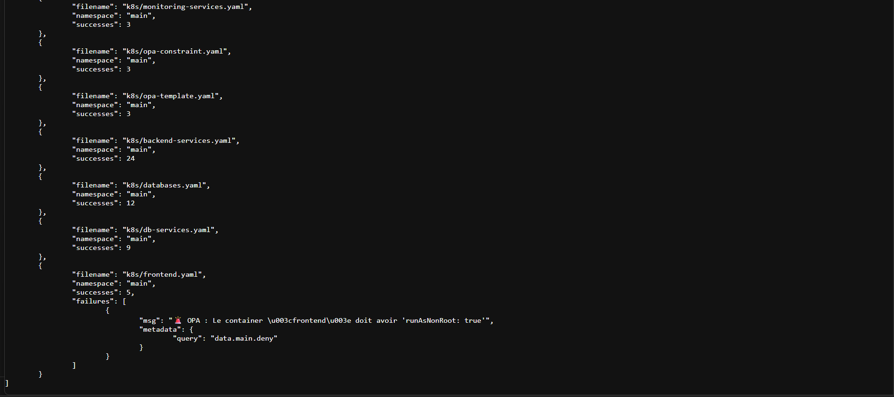 |

### Security scanning
| SonarQube (SAST) | Trivy (SCA) |
|---|---|
| 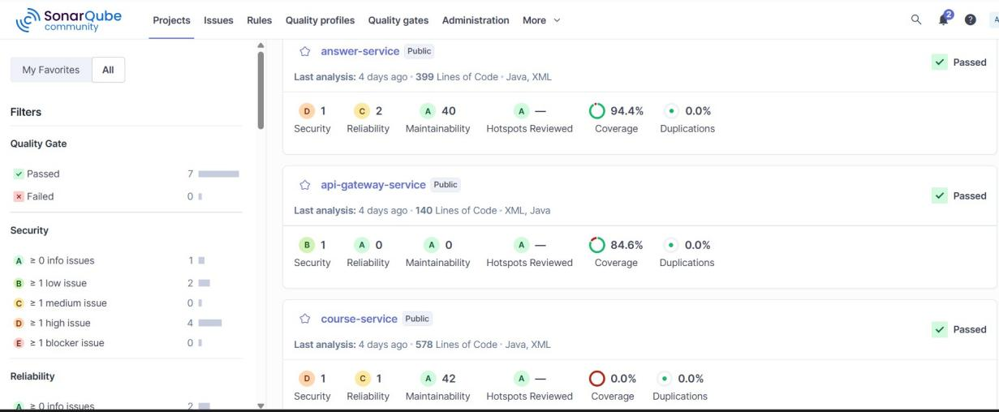 | 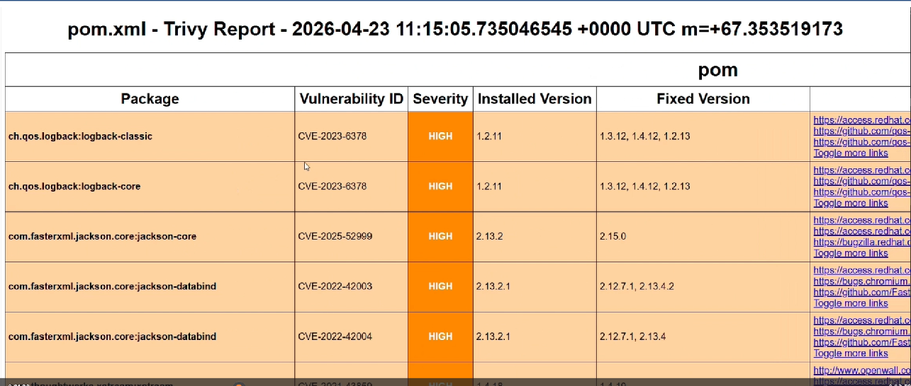 |
| **Gitleaks (secrets)** | **Cosign (signature verification)** |
| 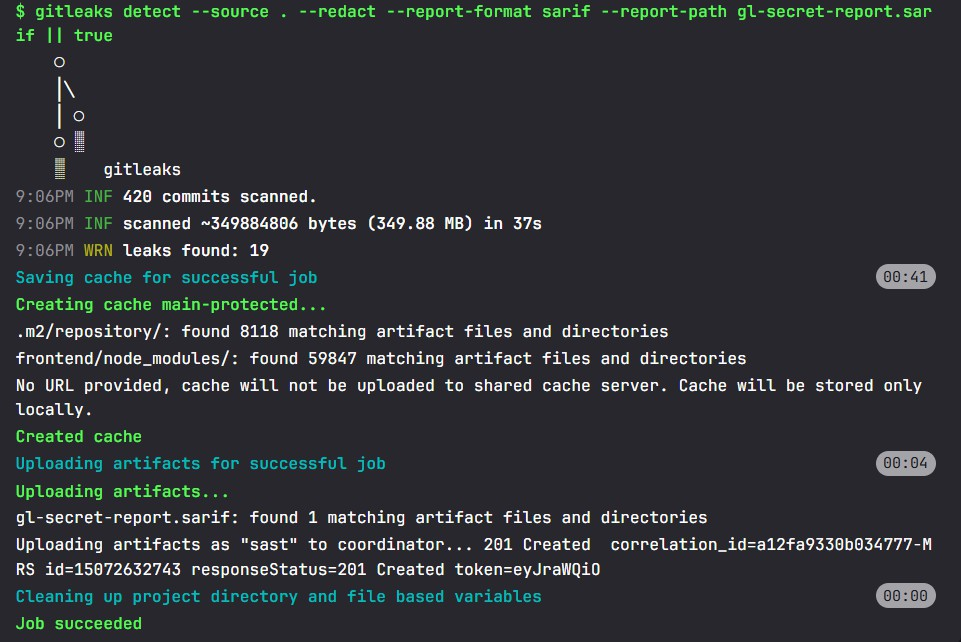 | 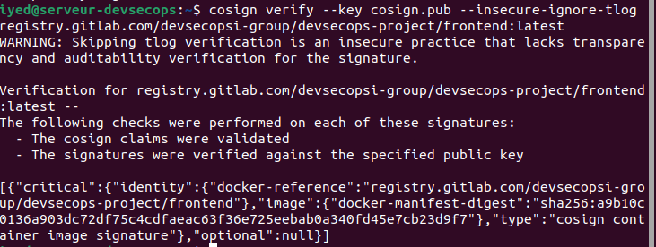 |
| **OWASP ZAP (DAST)** | **DefectDojo (centralised findings)** |
| 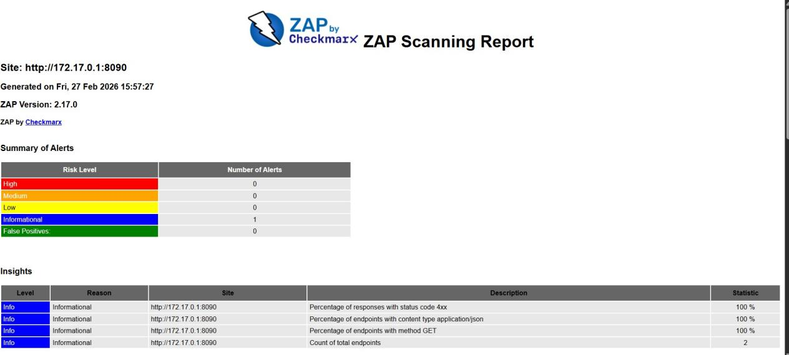 | 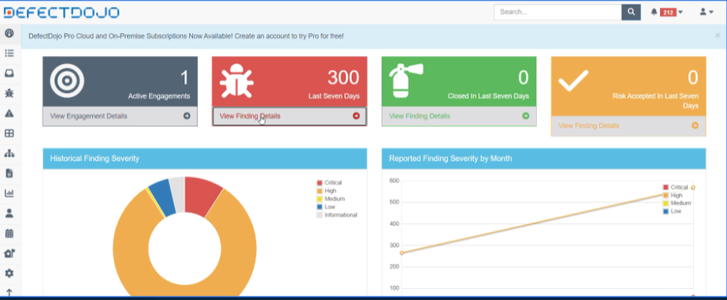 |

### Kubernetes and GitOps
| Argo CD: synced and healthy | Pods on DOKS |
|---|---|
| 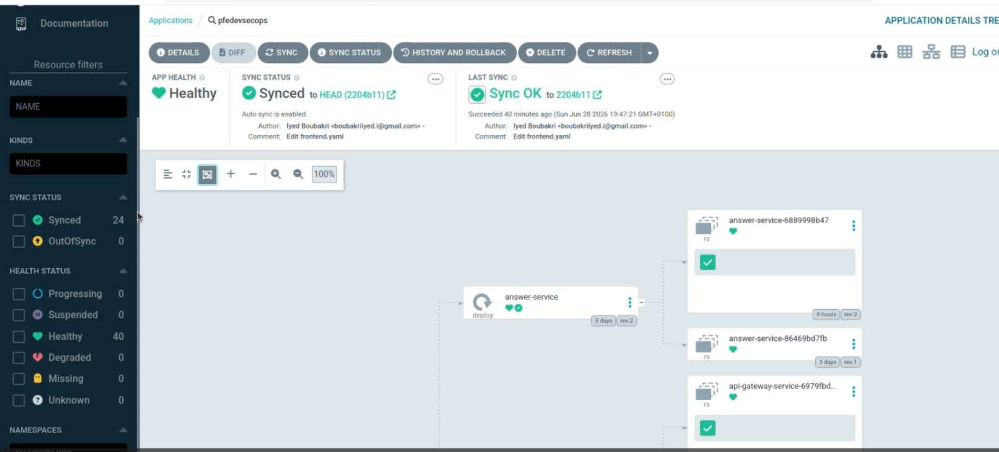 | 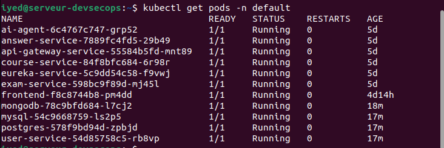 |
| **EduBoard running on DOKS** | **Prometheus targets** |
| 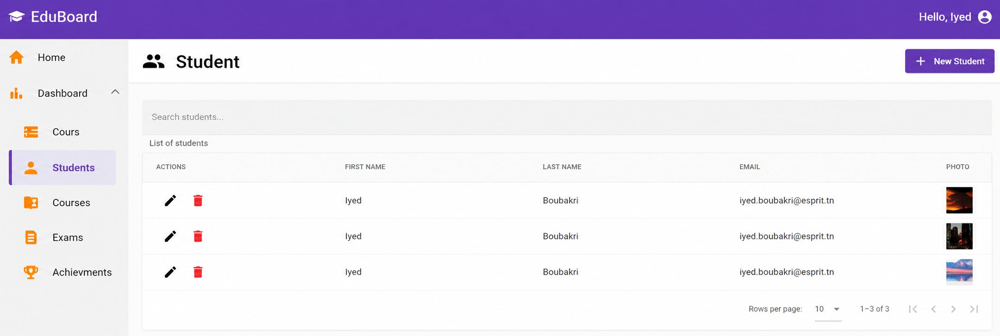 | 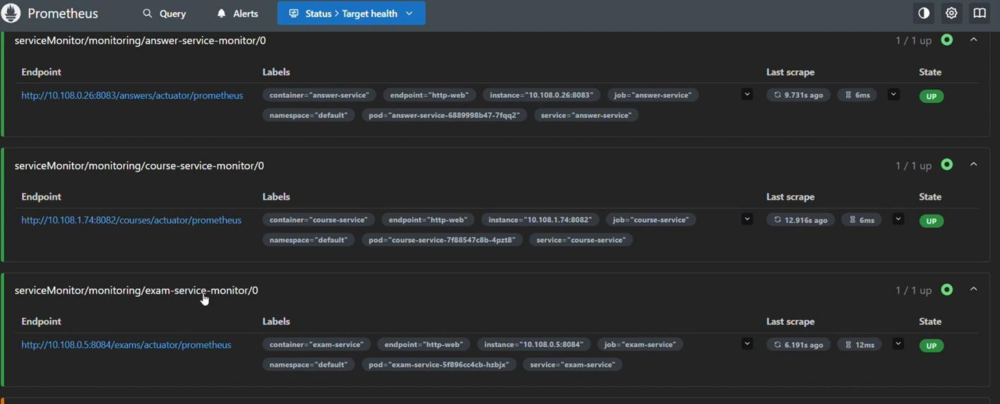 |

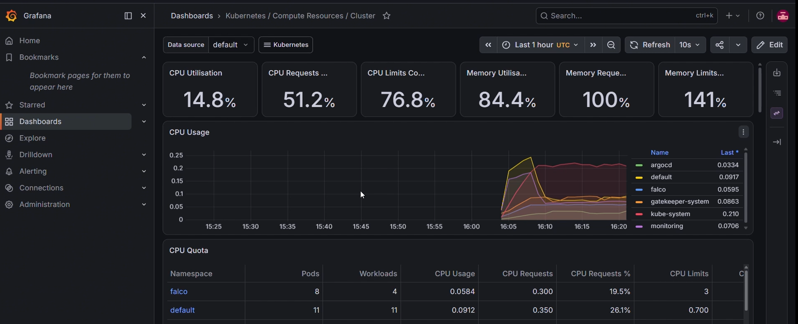

### Runtime detection → AI remediation (end-to-end demo)
| 1. Attack simulation: read `/etc/shadow` in the frontend pod | 2. Falcosidekick receives the event |
|---|---|
| 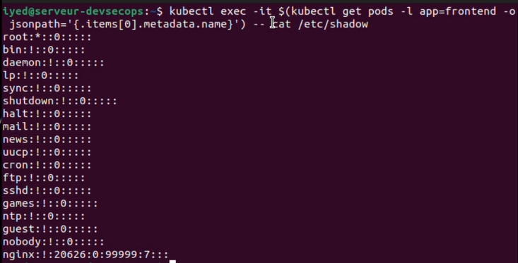 | 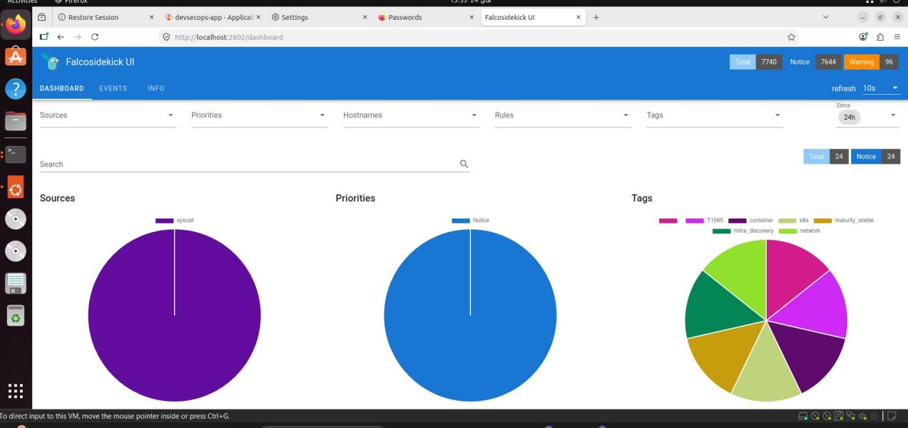 |
| **3. The agent receives the alert and calls Groq (Llama 3.3 70B)** | **4. Slack: severity, analysis, violated rule** |
| 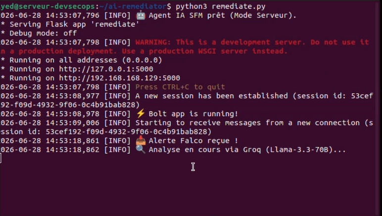 | 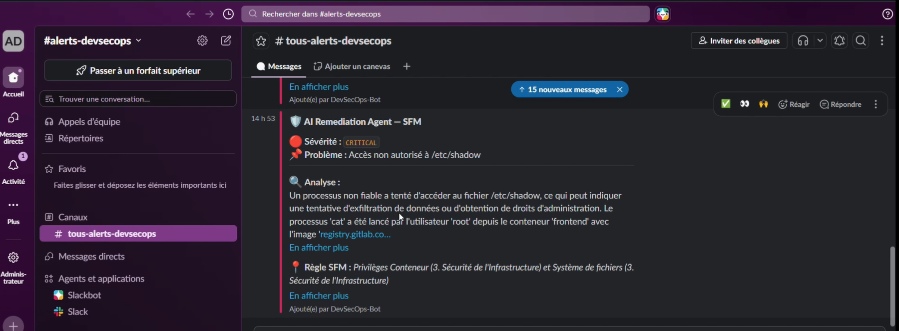 |
| **5. Slack: proposed fix with an "Apply fix" button** | **6. Human approval → patch applied, pods restarted** |
| 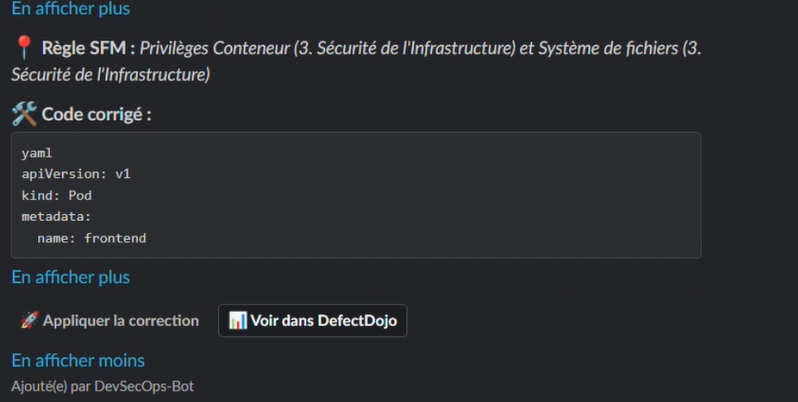 | 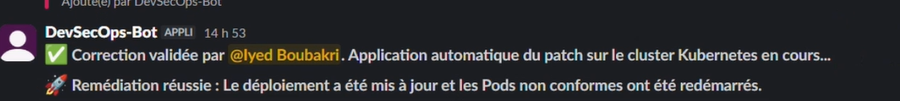 |

---

## Demo video

The end-to-end demo (attack → Falco → AI analysis → Slack approval → patch) was recorded for the PFE defence. The video link will be added here once it is published.

---

## Project results

Measured on the project environment during the PFE:

| Metric | Before | After |
|---|---|---|
| Kubernetes configuration compliance (OPA rules) | 38 % | **100 %** (no privileged containers, no pods without resource limits) |
| Pipeline execution time | baseline | **−40 %** (caching + parallel matrix scans) |
| DevSecOps maturity (OWASP DSOMM) | level 1 | **level 3** |
| Time to analyse a runtime alert and propose a fix | ~45 min (manual) | **~20 s** (AI agent → Slack) |
| Pipeline scope | — | 13 stages, 32 jobs, 7 signed images, 3-node cluster |

---

## Repository structure

```
.
├── .gitlab-ci.yml            # 13-stage DevSecOps pipeline
├── .plumber.yaml             # pipeline audit configuration
├── ai-remediator/
│   ├── remediate_groq.py     # AI agent - Groq / Llama 3.3 70B (report version)
│   ├── remediate.py          # AI agent - variant called by the CI job
│   └── knowledge_base/       # internal security standards used for RAG
├── backend/                  # Spring Boot microservices, Gateway, Eureka, shared modules
│   └── */Dockerfile.secure   # hardened, non-root images
├── frontend/                 # Angular application
├── k8s/                      # Kubernetes manifests, Rego policy, Gatekeeper template/constraint
├── gitops/                   # Argo CD Application
├── docs/
│   ├── architecture/         # architecture diagrams
│   └── screenshots/          # evidence from the real environment
└── sl-analysis.sh            # Qwiet preZero analysis script
```

---

## Known limitations

These items were identified during the project and are the next steps:

- Database credentials in `k8s/databases.yaml` and `k8s/backend-services.yaml` are inline demo values. In production they belong in Kubernetes Secrets backed by Sealed Secrets or HashiCorp Vault.
- Images use the `:latest` tag. Pinning images by digest would allow Cosign signatures to be enforced at admission, for example with Kyverno or the Sigstore policy-controller.
- Most security jobs use `allow_failure: true` so that the pipeline always produces a full report. A stricter mode would block the pipeline on CRITICAL findings.
- The runtime version of the AI agent (Flask / Slack Bolt) still has to be added to this repository.

---

## Author and contact

**Iyed Boubakri**, DevOps / DevSecOps / Cloud Engineer, Software Engineering degree from ESPRIT (Tunisia).

- LinkedIn: [linkedin.com/in/iyed-boubakri-1a1376327](https://www.linkedin.com/in/iyed-boubakri-1a1376327/)
- GitHub: [github.com/iyedboubakri12](https://github.com/iyedboubakri12)
- Email: [boubakriiyed.i@gmail.com](mailto:boubakriiyed.i@gmail.com)

The project was hosted by **SFM Technologies** (Tunis) as part of the ESPRIT engineering degree, 2025–2026.
